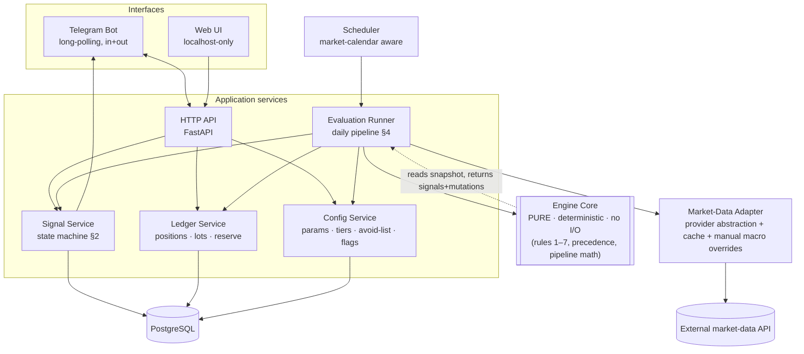

# tradr — System Architecture (v1)

Implements the **tradr rules engine ([RULESET.md](RULESET.md) v3)**: an advisory-only,
confirm-each, stateful rules engine for US equities, with a Telegram interaction
surface and a web UI for management. Hosted on a single VM.

> Supersedes the lightweight `DESIGN.md` (GitHub-Actions + flat-JSON) sketch. That
> model can't hold this spec: the signal state machine (PENDING→DONE/SKIPPED/EXPIRED),
> the notional reserve ledger, latched fired-band flags, hysteresis reset points, and
> the ordered daily pipeline are all **persistent, evolving state** — they need a
> database and a long-lived process, not stateless flat files.

> **Boundary reminder (from ruleset §0):** advisory only. The system never places
> orders, never touches money. Every state transition is driven by the user
> *confirming* a fill. Suggested sizes are arithmetic from your own locked rules —
> not investment advice, and market data can be stale or wrong. Treat every signal as
> a prompt to check.

---

## 1. Component overview



**The one design rule everything hangs on:** the **Engine Core is pure**. It takes an
immutable snapshot `(positions, band-state, reserve, params, market-data)` and returns
`(signals, state-mutations)` with **zero I/O**. All fetching, DB writes, and Telegram
sends happen in the services *around* it. This is what makes the engine (a) unit-
testable rule-by-rule, (b) **backtestable** by replaying historical snapshots — which
ruleset §8 open-items #4 explicitly asks for — and (c) deterministic, so the same
inputs always yield the same signals.

---

## 2. The layers

### Engine Core (pure Python — the crown jewel)
- Implements the **daily pipeline in the exact order of ruleset §4** (expire → trim →
  double-down → base DCA → cash-floor → gates → emit) and the **precedence table §6**.
- Input: a plain dataclass snapshot. Output: a list of proposed signals + a list of
  state deltas (band latches, reserve moves, snooze timers). It **proposes**; the
  Signal Service **commits**.
- No clock, no network, no DB. Time and prices are passed *in*. (Enables replay/backtest.)
- Fully covered by table-driven unit tests: one per rule, plus the nasty interactions
  the spec calls out — gap-through firing all bands, trim-beats-DD same-day suppression,
  shared-reserve deepest-`dd`-first contention, froth/momentum non-compounding floor at
  0.5, DD_CAP 3× clamp, MIN_WEIGHT floor, MAX_HOLDINGS "replace something?".

### Persistence — PostgreSQL
Postgres (not SQLite) because we have concurrent writers (bot, API, scheduler) and need
transactional integrity on the reserve ledger. Core tables:

| Table | Holds |
|---|---|
| `positions` | ticker, tier, shares, avg_basis, weight (derived) |
| `lots` | append-only fills: ticker, date, side, qty, price → source of truth for basis |
| `signals` | cause, action, size_hint, asset, band, **state**, timestamps, fill report |
| `band_state` | per ticker×ladder: armed/fired, rearm tracking, spike-peak, crash-cycle id |
| `reserve_ledger` | append-only entries (base-bank, trim-recycle, external top-up, DD-draw) + running balance |
| `params` | the §1 parameter table (editable via UI) |
| `universe` | ticker → tier (T1/T2/ETF/watch) and `is_avoid` flag |
| `flags` | emergency-fund attested, 50/50 auto-bank on/off, froth state, etc. |
| `market_snapshot` | per ticker per day: price, 52wk-high, 30-day return, fwd P/E |
| `macro` | S&P fwd P/E + its 10-yr avg (slow-moving; manual override supported) |
| `audit_log` | every state transition, who/what/when — reconciliation + trust |

All derived values (`avg_basis`, `weight`, `gain`, reserve balance) are **recomputed
from append-only lots/ledger**, never hand-edited — matches the spec's "positions built
from confirmations" model and gives a full audit trail.

### Market-Data Adapter
- One interface: `get_stock(ticker) → {price, high_52w, ret_30d, fwd_pe}` and
  `get_macro() → {sp_fwd_pe, sp_10yr_avg_fwd_pe}`. Provider swappable behind it.
- **Fail-safe (spec §Rule1 edge cases):** missing/halted quote → skip that name for the
  run, carry state, emit at most one "data unavailable" note. Never compute an action off
  a blank/zero price.
- **⚠️ The hard data problem — flagged, not hand-waved:** per-stock price / 52wk-high /
  30-day return are easy on any free tier. But **forward P/E per stock**, and especially
  **the S&P 500 forward P/E and its 10-year average**, are specialty figures — free APIs
  usually don't carry them, and the S&P 10-yr-avg-fwd-P/E typically comes from FactSet /
  Yardeni / WSJ. Two mitigations, both supported: (a) a paid provider (FMP / Twelve Data /
  EODHD) for the P/E fields; (b) since the macro figures move *monthly*, a **manual
  override field in the UI** so you enter S&P fwd P/E + 10-yr avg yourself and the engine
  reads them. Rule 4 (froth overlay) and the PE annotation degrade gracefully to "unknown"
  if absent, rather than blocking buys.

### Application services
- **Evaluation Runner** — orchestrates one pipeline run: pull confirmations since last
  run → update ledger → fetch market data → build snapshot → call Engine Core → hand
  proposed signals to Signal Service. Idempotent per (ticker, day) so a re-run is safe.
- **Signal Service** — owns the §2 state machine. Creates PENDING signals, sends them to
  Telegram, advances to DONE/SKIPPED/EXPIRED on user action, applies cooldown/snooze and
  hysteresis re-arm, commits the engine's proposed state deltas transactionally.
- **Ledger Service** — positions, lots, reserve ledger, external top-ups. All the write
  paths the UI and bot call.
- **Config Service** — params, tier membership, avoid-list, flags. Guardrails on edits
  (e.g. `DD_CAP` and "zero leverage" are hard-constrained; UI can surface but not violate
  the §0 non-negotiables).

### Scheduler
- Market-calendar aware (skip weekends + US holidays; gate to 09:30–16:00 ET).
- Runs the daily pipeline; **base-DCA step only on the scheduled monthly date** (or next
  trading day if closed), per Rule 7. Trim / double-down / cash-floor / expiry run every
  day. Frequency for intraday checks is configurable (start 2–3×/day, tune later).

---

## 3. Interfaces

### Telegram bot (your primary loop)
Two directions, **long-polling** (outbound connection only — so no inbound port, nothing
to expose; aligns with localhost-only hosting):

- **Inbound — log trades in your own words:** "bought 12 NVDA at 118 today", "sold 5 MSFT
  @ 430". Parsed into a structured draft, **echoed back for one-tap confirmation** before
  any DB write (never trust a silent parse of money-moving text). Also `/reserve +5000`
  style top-ups, `/holdings`, `/status`.
- **Outbound — signals with inline buttons:** each PENDING signal renders as a card with
  `✅ Done` / `⏸ Skip` buttons. Tapping **Done** opens a quick fill report (shares + price)
  that feeds basis/weight; **Skip** snoozes for `SNOOZE_DAYS`. This *is* the §2 lifecycle.

### Web UI (management console, localhost-only)
FastAPI backend + a lightweight frontend (React or server-rendered — see open questions).
Covers everything you listed:
- **Buyings add/remove** → create/void lots (a "remove" is a compensating entry, preserving
  the audit trail — we never hard-delete history).
- **External money** → reserve top-up entries; view the reserve ledger + earmark vs idle.
- **Tune defaults / change values** → the §1 parameter editor, with the locked/default
  labels from Appendix A shown inline, and hard-constraint guardrails.
- **Subscribe** → manage the universe: add/remove a ticker, assign its tier (T1/T2/ETF/
  watchlist), toggle avoid-list. ("Subscribe to a stock" = add it to the watched universe;
  notification on/off per name lives here too.)
- Plus: positions & weights dashboard, signal history + state, band-state inspector,
  reserve ledger, and the **periodic "reconcile against brokerage statement" prompt** the
  spec's open-item #2 asks for.

---

## 4. Deployment (single VM)

Docker Compose, all services on one host:

```
caddy/tailscale ─┐   (access via Tailscale or SSH tunnel — NOT public)
                 ├─ web-ui        (bound 127.0.0.1)
                 ├─ api           (bound 127.0.0.1, FastAPI + uvicorn)
                 ├─ bot           (Telegram long-polling worker)
                 ├─ scheduler     (pipeline cron, market-calendar aware)
                 └─ postgres      (bound 127.0.0.1, volume-backed)
```

- **All services bind `127.0.0.1`.** The UI is reached via **Tailscale (recommended) or an
  SSH tunnel** — nothing is exposed on `0.0.0.0`, no public port, no public URL. (Org
  policy + this being your full portfolio: keep it private, internal-only.)
- **Secrets** (market-data key, Telegram bot token + your chat ID, DB password) live in
  env / a secrets file that is git-ignored — never committed, never echoed back in logs.
- **Backups:** nightly `pg_dump` to encrypted local storage (your holdings + basis are the
  irreplaceable asset here). Restore drill documented.
- **Engine is a versioned library** inside the repo; the runner, bot, and API all import
  the same pure core, so a signal you see in Telegram is reproducible in a backtest.

---

## 4a. Open-source: strict code ↔ config split

This ships as an **open-source, self-hosted, single-user-per-instance** app. Each user runs
their own VM + DB; nobody's holdings ever touch a shared server. The overriding rule:

> **No personal data in the repo, ever.** All user-specific values live in the database,
> entered through the UI — never in source, never seeded with anyone's real numbers.

- **Config, not code** — `BASE_UNIT`, tier membership, ETF core pick, avoid-list,
  emergency-fund flag, macro P/E entries, API keys, Telegram token, and any Appendix-A
  overrides are all DB-backed and UI-editable. The `params`/`universe`/`flags`/secrets are
  the *entire* per-user surface.
- **What ships in the repo:** the engine + services, the Appendix-A **locked/default**
  values as generic starting points (labeled as defaults, not personal advice), an **empty
  universe**, `.env.example`, a license, and setup docs.
- **First-run setup wizard (UI)** — a fresh clone boots into onboarding that collects exactly
  the Appendix-A.8 blanks (`BASE_UNIT`, tiers, avoid-list, emergency flag) + API keys +
  Telegram bot token. **The engine refuses to run until required config is present** (fail
  closed — never compute sizes off missing config).
- **Neutral framing** — the shipped product is the generic rules engine; any particular
  investing philosophy is just *one example strategy config*, not the app's identity.
- **License:** Apache-2.0 suggested (permissive + explicit patent grant). User's final call.
- **Secrets** stay in env / git-ignored files; `.env.example` documents the shape only.
- **Publishing is the user's own action** — this design produces an open-sourceable repo; the
  actual public push / hosting is done by the user, not automated here.

## 5. Build order

1. **Config system, not seeded values** — build the `params`/`universe`/`flags` schema + the
   UI setup wizard so a new user enters `BASE_UNIT`, tiers, ETF pick, avoid-list, and the
   emergency flag themselves. Ship only Appendix-A generic defaults; **no personal seed data**.
2. **Data model + migrations** (Postgres schema above).
3. **Engine Core + test suite** — pure, no I/O; every rule + every nasty interaction. This
   is the bulk of the correctness work; do it first, backtest it in isolation.
4. **Ledger + Config services + market-data adapter** (with manual macro override).
5. **Evaluation Runner + Scheduler** — wire the pipeline; run in **dry-run** (print, don't
   send) for a week against live data.
6. **Telegram bot** — outbound signal cards + inbound trade logging + confirm loop.
7. **Web UI** — CRUD, parameter editor, dashboards, reconcile prompt.
8. **Backtest sanity pass** on `FROTH_THRESHOLD` / `BRAKE_RELEASE_PCT` (open-item #4) before
   trusting live signals.

---

## 6. Resolved decisions

- **Market data → free quotes + manual macro (start here).** Free source for price /
  52wk-high / 30-day return (adapter computes 30-day return from daily closes — allowed,
  since only the *pure engine* is barred from touching raw series, not the adapter). The
  S&P fwd P/E + 10-yr avg are entered monthly in the UI. Rationale: valuation is the least
  load-bearing input — per-stock P/E is advisory-only, froth is a soft ×0.5 on monthly DCA,
  double-downs are PE-exempt. Adapter interface stays provider-agnostic so a paid upgrade
  (FMP / Twelve Data / EODHD) is a one-file swap if the froth overlay proves central.
- **Trade logging → structured commands.** `/buy TICKER QTY PRICE [DATE]`, `/sell …`,
  `/reserve +AMOUNT`. Fully deterministic, no LLM, no parse ambiguity. Bot still echoes a
  confirmation card before writing.
- **Frontend → React SPA.** Separate build + service on the VM; `api` stays the single
  backend both React and the bot call.

## 7. Standing risks (not decisions — things to keep watching)

- **Free-tier data** rate-limits / term changes → the adapter fail-safe (skip name, never
  act on blank/zero price) is mandatory, and one "data unavailable" note max per run.
- **Positions integrity** — everything (`gain`, `MIN_WEIGHT`, weights, core %) depends on
  you reporting fills accurately; the reconcile prompt is the safety net. No brokerage sync
  by design.
